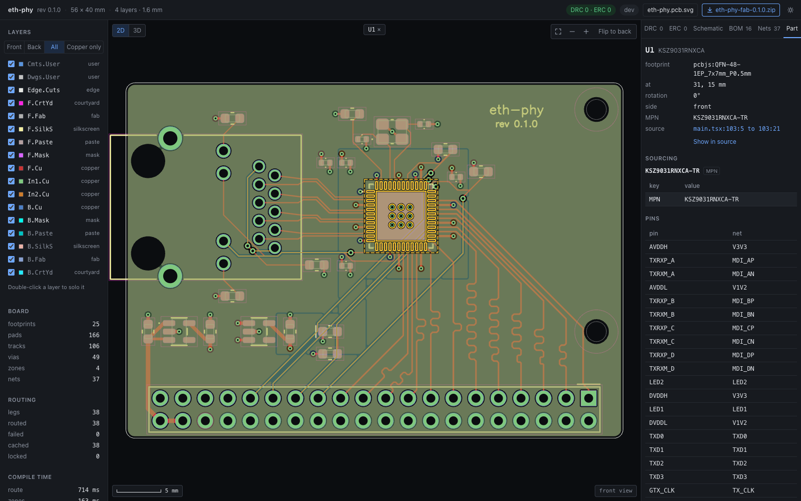
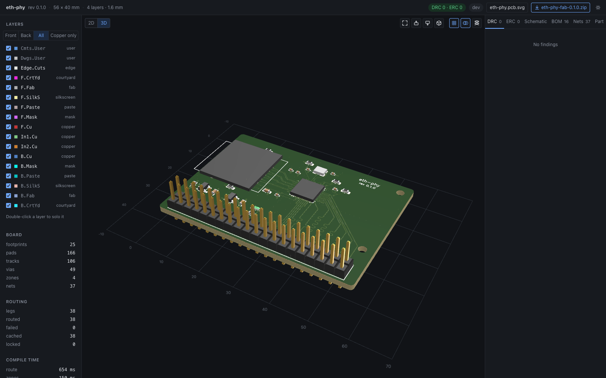
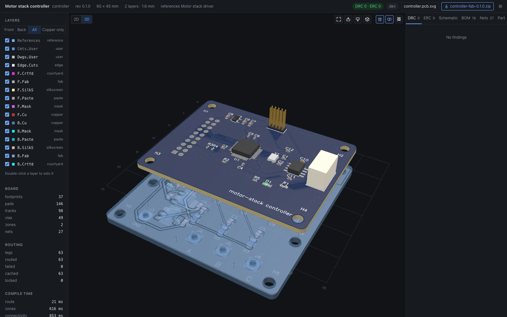

# pcbjs for VS Code

Design a PCB as TypeScript and JSX and see it beside the code. The extension runs your project's pcbjs, shows the board in 2D, 3D and the schematic in editor panes, and links code and board both ways: the cursor highlights what a line drew, and what you select on the board selects its code, with Open placement and Open definition a click away.

## Features

- Live preview in panes beside the code: 2D, 3D and schematic, recompiled as you type.
- Cursor to board: the item under the cursor lights up in every view.
- Board to code: a selection on the board selects its code; the chip's Open placement and Open definition open the line that placed it and the footprint definition.
- Hovers with a picture of what the code drew, its values and its findings.
- Code lenses with route lengths, targets and skew; inlay hints with the net of a pad.
- DRC and ERC findings in Problems and in the sidebar, each a click from its code.
- Inline value editors for positions, rotations, layers and route commands, each one undoable edit.
- Sidebar with the boards, findings, nets and BOM of the project.
- New project, board wizard, examples, Convert from KiCad and agent skills from the Get started walkthrough.
- File icons for boards, schematics, footprints and fab zips.

## Get started

1. Install pcbjs in a project, Node 22.12 or newer: `npm install -D @pcbjs/pcbjs@^0.1.0`, or run `pcbjs: Create project in workspace` and let the extension do it.
2. Open `pcb.tsx` and press ctrl+alt+2, cmd+alt+2 on macOS, for the 2D view beside it.
3. Edit the code; the board follows.

The extension carries no pcbjs: each project runs its own, so projects on different versions work side by side. `pcbjs ide install` in a project installs the extension bundled with its pcbjs.

## Docs

- [Basics](https://pcbjs.dev/docs/basics): a first board end to end.
- [Editor](https://pcbjs.dev/docs/editor): what the extension shows in the code.
- [VS Code extension](https://pcbjs.dev/docs/vscode): every command, setting and how it attaches.
- [Source and issues](https://github.com/pcbjs/pcbjs).
